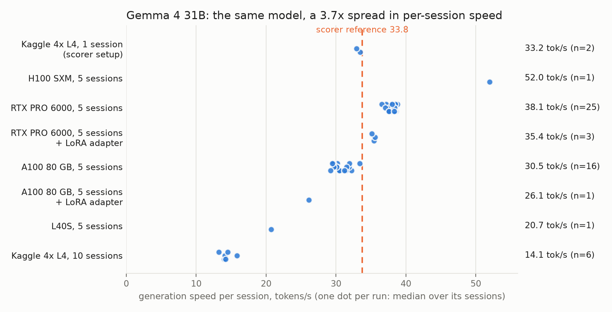
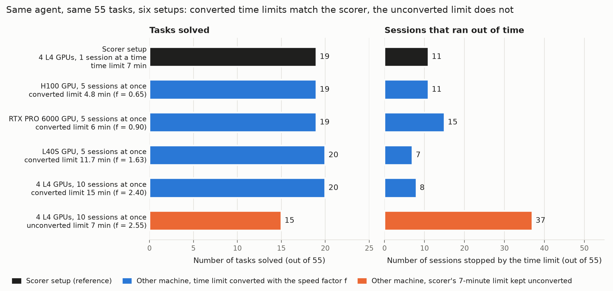

## Abstract

Benchmarks for AI coding agents commonly limit the time an agent may spend on each task. Such a limit, however,
measures the computer as much as the agent: a slow machine completes less model work in 7 minutes than a fast one, so
the same agent obtains different scores on different machines. Previous work has examined how agents react to a time
budget, but not how a time limit should be converted between machines. In this work, we propose **scorer minutes**:
the minutes spent on a machine divided by a speed factor *f*, which states how much slower that machine is than the
official scoring machine (the "scorer") and is measured from the logs of any agent run. We release
**scorer-minutes**, a toolkit and a protocol that compute the factor and the time limit to set, check whether one
factor is sufficient, and report the variation between identical runs. Experiments were performed in a Kaggle
competition in which an agent built on Google's Gemma 4 model fixes bugs in Python projects. Across 106 runs on six
kinds of GPU, the same model wrote 13 to 52 tokens (word pieces) per second. In a control experiment (one agent, 55
tasks), the scorer's setup solved **19** tasks; four other machines with converted time limits solved **19-20**; a
2.6x slower machine that kept the scorer's 7-minute limit solved **15** and ran out of time on 37 tasks. Identical
runs differed by a standard deviation (SD) of **1.1-1.7 tasks of 55**, so one run per agent ranks a true 2-task
difference wrongly 11-20% of the time. The study shows that time-limited results can be made comparable across
machines from logs alone.

## 1. Introduction

**The competition.** In Kaggle's "Gemma 4 Developer Agent" competition (kaggle.com/competitions/gemma-4-developer-agent),
participants build an *agent* that fixes bugs
in software. The agent is one of Google's open Gemma 4 language models with a prompt and a few tools: run a shell
command, read a file, edit a file, submit a fix. A *task* is a copy of a Python project that contains a bug, with a
written bug report. The agent works in a loop: the model asks for a tool, the tool runs, and its output goes back to the model, until
the agent submits a fix. One such attempt at one task is a **session**.
A task is solved if the project's hidden tests pass after the fix. The score is the share of tasks solved.

**The scorer and its time limits.** Kaggle scores each submission on about 120 hidden tasks, on a machine we call the
**scorer**: four NVIDIA L4 GPUs, working on one session at a time. Every session has a limit
chosen by the participant, the **cap** (ours is 7 minutes); a session that reaches it is stopped. All sessions
together must finish within 12 hours, or the submission scores nothing.

**The problem.** Participants get one scored submission per day, so they test elsewhere: on rented GPUs, or on the
scorer's kind of machine with 10 sessions at once to save time. Each generates text at a different
speed, so "7 minutes" buys a different amount of work on each. A cap that is fine on a fast machine can break the
12-hour limit on the scorer; the scorer's cap on a slower machine stops sessions the scorer would let finish. Results are also noisy: the same agent solves different tasks on every run, so a
gain of one or two tasks may be luck.

**The idea.** Treat the cap as a budget of model work, not of minutes. One number per run, the speed factor *f*,
converts between the two: if your machine generates text half as fast as the scorer, f = 2, and a budget of 7 scorer
minutes means a 14-minute cap.

**What we release (the resource).** The `scorer-minutes` toolkit, the speed, timing and noise data of 106 runs
including a control experiment on the scorer's own setup, and a one-page protocol.

## 2. Related work

Wang et al. [On the Clock, arXiv 2610.10833] study how agents react to a stated time budget, not what the clock means
on different hardware. Benchmarks report wall-clock time within one environment [OpenHarmony Bench, arXiv 2608.16022]
or apply one limit without normalizing it [AnalysisBench, arXiv 2604.11270]. For noise we follow Miller
[arXiv 2411.00640]; "On Randomness in Agentic Evals" [arXiv 2602.07150] finds SWE-bench Verified scores shifting
2.2-6.0 points across runs. In this competition, public notebooks measure model speed at one load level
[P. D. Pereira, "L4 Decode Law & 12-Call Cliff"], leaderboard noise [D. Afshar, "58 Tasks, Bronze Is a 124-Team Tie"]
and whether a configuration fits the 12 hours [V. Murugan, "Budget Feasibility Audit"]. We know of no protocol that
converts a cap between machines or measures repeated-run noise.

## 3. The resource

The toolkit (Python standard library only) has four commands (`calibrate`, `timing`, `noise`, `draws`). They read OpenAI, LiteLLM or vLLM logs, are deterministic
and are covered by 16 tests.

### 3.1 Definitions

A language model reads and writes text in **tokens** (pieces of words). Each time the agent calls the model, the model
first reads its prompt (**prefill**) and then writes its answer (**decode**). Everything below is computed from the
log of these calls: when each call started and ended, and how many tokens it read and wrote.

* **Session speed** `v_s` = tokens written / time spent in model calls (prefill time included).
* **Run speed** `v` = the median of `v_s` over all sessions of a run, with a bootstrap confidence interval (CI).
* **Speed factor** `f = v_ref / v`, where `v_ref` is the speed of the scorer. f > 1 means slower than the scorer.
* **Scorer minutes** = wall-clock minutes / f. A budget of *B* scorer minutes needs a cap of `B x f` minutes.

The `calibrate` command prints f and the cap. We measured `v_ref` by running sessions one at a time on the scorer's
kind of machine: **33.8 tokens/s** (5 sessions, IQR 32.8-34.4). The 56 scorer sessions of Section 4.2, run later, measured 33.4 and 32.9 in two parts, within 2.5%.

### 3.2 When one factor is enough

One factor is enough only if sessions spend nearly all their time in model calls, at a roughly constant speed. The
`timing` command checks this on the same logs. It reports:

* the **model share**: time in model calls / total session time (the rest is tools);
* **late / early**: the speed in the last third of each session's calls over the speed in the first third;
* a fit that splits each call's time into a fixed overhead, prefill per new prompt token, decode per written token, and the slowdown of decode as the conversation grows.

It flags sessions with a model share < 0.9 or a prefill share > 0.2.

## 4. Experimental setup and results

* **Tasks.** The competition publishes 129 practice tasks from four open-source Python projects. Each task carries the project's code just before a real bug fix, the bug report, the maintainers' fix, and the tests that the fix makes pass. We use the 110 tasks (63 from FastAPI, 47 from Rich) on which the maintainers' fix passes in our grading sandbox, in two halves that share no task: **train** (55 tasks: 31 FastAPI, 24 Rich), on which we develop agents, and **held-out** (55: 32 and 23), on which we only measure. The control experiment (4.2) uses train; the noise study (5) uses both.
* **Grading.** After a session, the task's tests, which the agent never sees, run in the competition's official software image; a task is solved only if all pass.
* **Model.** Gemma 4 in the compressed ("quantized") versions the competition provides. 82 of our 106 runs use the largest, 31B (31 billion parameters); the rest use smaller ones (E4B 14, 26B-A4B 9, 12B 1).
* **Model server.** On each machine the model runs in one vLLM server, an open-source program that loads the model on the GPUs and answers the agent's calls. Sessions that run at once share the server, so each one gets slower.
* **Machines.** The scorer's kind of machine is available in Kaggle notebooks: four L4 GPUs ("4x L4"), with the model split across them ("TP4"). Running one session at a time, as the official scoring does, it is our **scorer setup**. We also ran it with 10 sessions at once, and rented single, larger GPUs (H100, A100, RTX PRO 6000, L40S) with 5 sessions at once unless noted. A **setup** is a machine together with its number of parallel sessions.
* **Agent.** A name such as g31_v12e denotes one configuration (prompt, tools, limits) of our 31B agent, run by the competition's own agent program. A session ends when the agent submits, after 28 tool calls, or at the cap; a session stopped by the cap is **timed out**.
* **Runs.** A run is one pass of one agent over a task list on one setup. Of 106 logged runs (4,757 sessions), 76 are full (>= 20 sessions; 4,542 sessions).
* **Budgets and caps.** The budget is 7 scorer minutes unless noted. A **converted** cap is the budget multiplied by the setup's f. A **nominal** cap is the scorer's 7 minutes used unchanged.

### 4.1 Speed depends on the GPU and on how many sessions share it

The table lists all 59 full runs of the 31B model by setup (Figure 1). In the "attempts" rows, each task is tried 2 or 3 times at once.

| Setup (31B) | Sessions in parallel | Runs (sessions) | Tokens/s per session, median (range) | Factor vs scorer |
|---|---|---|---|---|
| **Kaggle 4x L4, TP4 (scorer setup)** | 1 | 2 (56) | 33.2 (32.9-33.4) | 1.01-1.02 |
| H100 SXM 80 GB | 5 | 1 (55) | 52.0 | 0.65 |
| RTX PRO 6000 96 GB | 2 / 5 | 1 (24) / 25 (1,540) | 36.1 / 38.1 (36.5-38.8) | 0.94 / 0.87-0.92 |
| RTX PRO 6000, + LoRA adapter B | 5 | 3 (165) | 35.4 (35.1-35.6) | 0.95-0.96 |
| RTX PRO 6000, 5 workers x 2 parallel attempts | 10 | 2 (104) | 26.4 (25.7-27.2) | 1.24-1.31 |
| A100 80 GB | 5 | 16 (948) | 30.5 (29.2-33.4) | 1.01-1.16 |
| A100 80 GB, + LoRA adapter A | 5 | 1 (55) | 26.1 | 1.29 |
| A100 80 GB, 4 workers x 3 parallel attempts | 12 | 1 (25) | 16.9 | 1.99 |
| L40S 48 GB | 5 | 1 (55) | 20.7 | 1.63 |
| Kaggle 4x L4, TP4 | 10 | 6 (261) | 14.1 (13.2-15.8) | 2.13-2.55 |

Three lessons:

* **The number of parallel sessions matters as much as the GPU.** The scorer's own kind of machine, with 10 sessions at once, is 2.1-2.6x slower per session.
* **Small changes move the factor.** A LoRA adapter (extra trained weights served with the model) cost 7-16% of speed. With adapter B on the RTX PRO 6000, sessions became 12% longer, which moves the projected total time on the scorer from 10.3-10.8 h to 11.6-12.1 h of the 12-hour limit.
* **Speed is stable within a setup** (A100: factors 1.01-1.16 over 16 runs) **but not across runs that look equal** (E4B on one RTX 5080 GPU: 24 to 90 tokens/s). So calibrate every run.

*Figure 1. One dot per run; the dashed line is the scorer's speed (33.8 tokens/s).*

### 4.2 Converted caps reproduce the scorer

**The test.** We ran one agent (g31_v12e, budget 7 scorer minutes) on the 55 train tasks on seven setups. The
reference is the scorer setup with its 7-minute cap. If the conversion is right, converted caps should match the reference and the nominal cap should not.

**The caps** were set before each run, from a calibration of 5 sessions or from earlier runs on that setup. The table
gives the factor measured afterwards on the full run, so the budget a run really got is cap / f (Figure 2).

| Setup | f (full run) | Wall cap (set in advance) | Scorer min (cap / f) | Solved / 55 | Timed out | Overlap with scorer (both / scorer only / run only) |
|---|---|---|---|---|---|---|
| **Kaggle 4x L4, 1 session (scorer)** | 1.02 (reference run) | 7 min | 6.9 | **19** | 11 | - |
| H100 SXM, 5 sessions | 0.65 | 4.8 min | 7.4 | 19 | 11 | 16 / 3 / 3 |
| RTX PRO 6000, 5 sessions | 0.90 | 6.0 min | 6.7 | 19 | 15 | 18 / 1 / 1 |
| L40S, 5 sessions | 1.63 | 11.7 min | 7.2 | 20 | 7 | 17 / 2 / 3 |
| Kaggle 4x L4, 10 sessions, converted | 2.40 | 15 min | 6.3 | 20 | 8 | 17 / 2 / 3 |
| Kaggle 4x L4, 10 sessions, **nominal** | 2.55 | 7 min | **2.7** | **15** | **37** | 14 / 5 / 1 |
| A100, 5 sessions (development reference) | 1.08 | 7 min | 6.5 | 17 | 12 | 14 / 5 / 3 |

**Converted caps work.** The four runs calibrated in advance land within one task of the scorer, on machines from
1.5x faster (f = 0.65) to 2.4x slower, although the factors estimated before the runs were off by up to 12% (realized
budgets 6.3-7.4 scorer minutes). The A100 run (our earlier reference) is within two.

**The nominal cap does not.** That run gets only 2.7 scorer minutes, and 37 of its 55 sessions time out (no timed-out
session was solved in any run). It solves 4 fewer tasks than the scorer and 5 fewer than its converted twin on the
same machine, about 3 SD of the difference between two identical runs. A paired McNemar test on the 7 tasks where the twins disagree gives p = 0.13.

**How much does an error in the factor cost?** On one setup (RTX PRO 6000, 5 sessions) we converted caps for budgets
of 3.5, 7 and 10 scorer minutes (`budget_curve.csv`): 16, 18 and 21 tasks solved, or 0.76 tasks per scorer minute.
So a 10% error in the factor at 7 minutes costs about half a task, less than the run-to-run noise; the nominal cap's
2.6x error cost 4-5.

*Figure 2. Converted time limits (blue) match the scorer (black); the unconverted limit (orange) does not. The A100 row of table 4.2 is not shown.*

### 4.3 Why one factor works here

The condition of Section 3.2 holds here. In all 76 full runs, model calls take 0.965-0.998 of session time. Within
model calls, prefill takes only 2.3% of the time (median; max 5.5%), because the server caches the part of the prompt
it has already read. Decode carries the hardware difference: per 1k tokens written, the scorer setup needs 26.6 s,
the same machine with 10 sessions 62.5 s, and the H100 17.0 s (`timing_coefs.csv`).
Decode slows as the conversation grows (at 24k tokens, by 14% on the scorer and 4% on the L40S), but one agent builds
similar conversations on every machine, so one factor absorbs it. The exception is heavy sharing: with 10 sessions at
once, late calls run up to 27% faster than early ones, as other sessions finish.

## 5. Noise

The `noise` command takes one row per run and task. It reports the SD of the score between identical runs and a
task-level SD that treats each task as a coin with its own solve rate; from these, the runs needed to detect a margin
and the chance that one run each ranks two agents wrongly. `draws` does the same for single leaderboard scores.

### 5.1 Local runs

Repeated full runs on the same 55 tasks (7 scorer minutes; A100 for the first four configurations, RTX PRO 6000 with
converted caps otherwise).

| Config | Split | Solved per run |
|---|---|---|
| g31_v12 / g31_v12d / g31_v9d | train | 20, 19 / 20, 18 / 19, 19 |
| g31_v12e (A100 / RTX PRO 6000) | train | 17 / 19 |
| g31_v9c / g31_v15 | train | 15, 13 / 19, 21 |
| g31_v15 / g31_v15 + adapter B | held-out | 18, 20 / 20, 21 |

Between two identical runs, 4-6 of the 55 tasks flip: solved in one run, not in the other. Pooled over the seven
repeated pairs (without the g31_v12e pair, which ran on two machines), the run SD is 1.14 tasks on train, 1.12 on
held-out, **1.13 over both (95% CI 0.75-2.31, 7 dof)**; the task-level SD is 1.52 and 1.66.

When two agents are compared with one run each, a true 2-task margin is ranked wrongly 11% of the time with the run SD
and **20%** with the larger task-level SD (1.66; 11% with two runs each); a
1-task margin, 34%. Detecting a 2-task margin with 80% power takes **11 runs** per agent.

### 5.2 The leaderboard

The public leaderboard shows one score per submission, on about 58 of the hidden tasks. Resubmissions of identical
files vary with an SD of 1.4-1.8 tasks [D. Afshar; forum]. With SD 1.6, the 95% interval of one score is about +-3 tasks (`draws --sd 1.6 --score 9`:
5.9-12.1).

## 6. Protocol

1. **Log every model call** with timestamps and token counts.
2. **Measure the reference speed** on the scoring setup, at the load it scores with.
3. **Calibrate every run**: cap = budget x f; report f with its CI.
4. **Check the assumption** (`timing`); if a run is flagged, measure on the scorer.
5. **Report budgets in scorer minutes**, with timeouts and projected total time.
6. **Run every configuration at least twice**; report the pooled SD and runs needed before claiming a margin.
7. **Read a leaderboard score as an interval**, not a rank.

## 7. Limitations

* One factor per run averages over the drift that heavy sharing causes.
* One model family, one agent program, Python projects only; agents that spend much time in tools need more than one factor.
* The scorer reference rests on one kind of machine (61 sessions on Kaggle 4x L4, 32.9-33.8 tokens/s); variation between hosts is not measured.
* Only one converted setup was repeated (19, 18).
* Noise estimates rest on seven repeated pairs; the task-level SD assumes independent tasks; leaderboard noise is partly community-reported.

## 8. Conclusion

A time limit is a hardware setting until it is converted. One factor from the logs of model calls, checked against the
same logs, makes local results comparable to the scorer's; two runs and a pooled SD make them comparable to each
other. Any timed benchmark whose agents spend their time in the model can use the same logs and commands.

**Reproducibility.** Toolkit and tests (`toolkit/`, Apache-2.0), notebook, data with data card (`data/README.md`) and
the scripts behind every table: github.com/akanksha28pathak/scorer-minutes-paper. The data card describes the tasks, the two splits and every file. The
tasks, the agent program and its documentation (`HARNESS_README.md`) are on the competition's data page
(kaggle.com/competitions/gemma-4-developer-agent/data) and may not be redistributed, so our files carry anonymous task
ids and no task content. Serving: vLLM 0.19.1, it-qat-w4a16 checkpoints.
